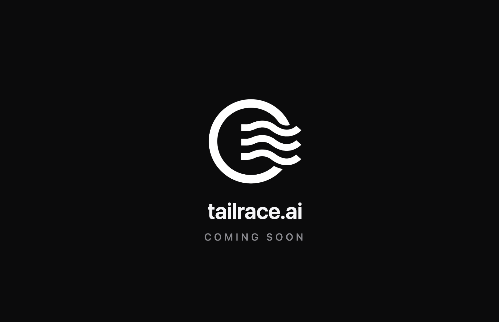

Upcoming ecosystem of AI first enterprise-grade products for workflow, data, AI automation, data lineage and AI plugin marketplace. 
These will compete with products like Alteryx, Pentaho, IBM Lineage and Atlan. 

All single-binary servers. Install in seconds on any platform, build visually or tell AI to build, runs forever — on a laptop menu bar that no tech people can use or as a service in a clustered fleet. Deterministic, auditable workflows that can call AI and be fully managed and extended by AI. Keyboards will be gone in 25 years. We are getting ready.

