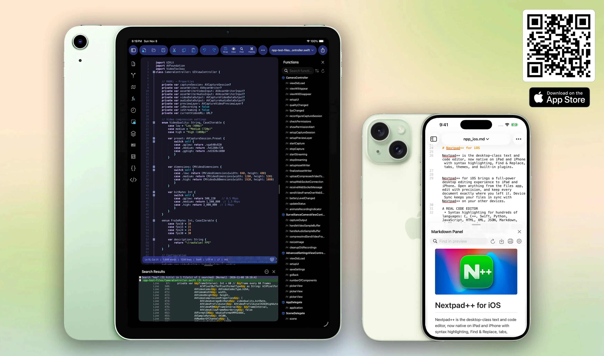
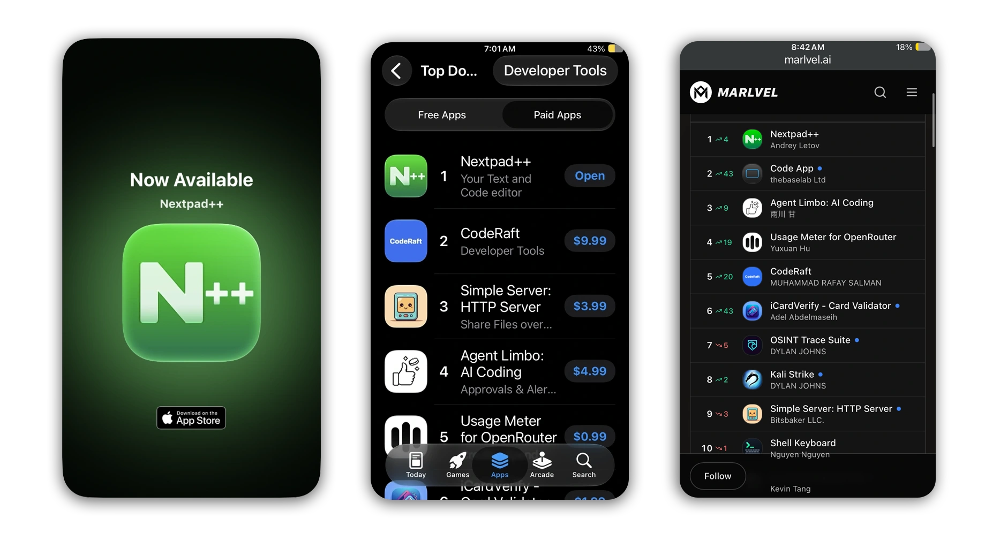

Nextpad++ comes to iOS (iPad and iPhone). It will become more and more polished and useful and will catch up to its macOS and Linux siblings very soon.

I'm super greateful for user support. Your support keeps the macOS and Linux versions free, and it lets me keep building new free tools. Thank You. On the side note, Nextpad++ for iOS went to the #1 spot in the App Store Developer tools in about 4 days.

